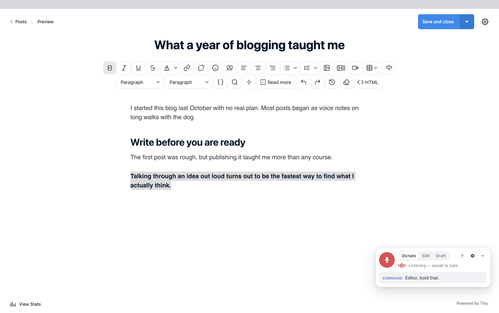
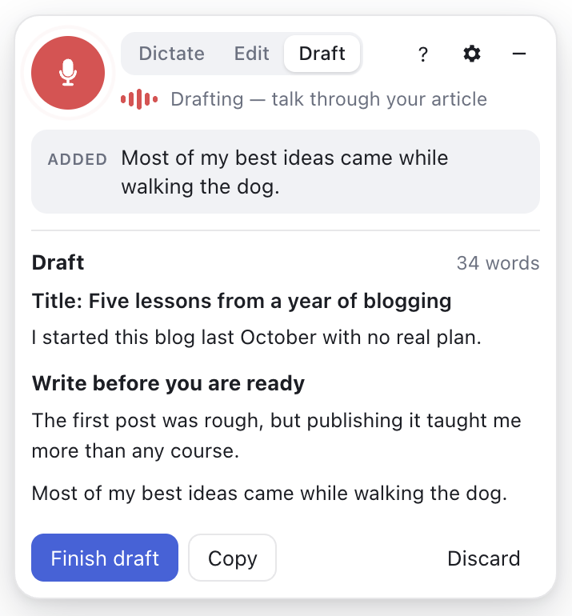
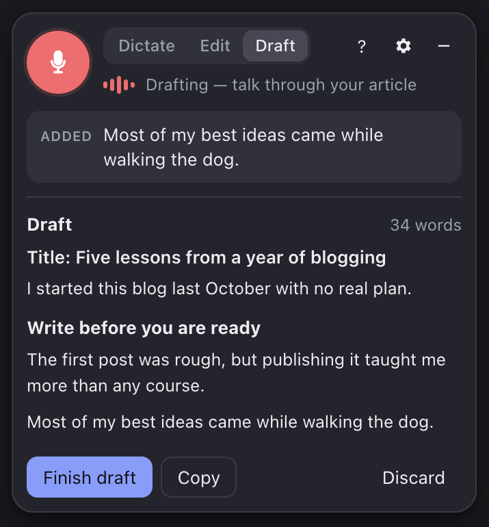

# Talk It Out

**Write your Publii posts by talking.** Dictate at the cursor, talk through a whole article and have it drafted for you, then fix it up by voice: "replace this with that", "make this a heading", "Claude, tighten this paragraph".

A plugin for [Publii](https://getpublii.com), the open-source static site CMS. It works in all three Publii editors: WYSIWYG, Block and Markdown.



## What it does

- **Dictate.** Speech is typed where your cursor is, with spacing and capitalisation handled. Say "new paragraph", "scratch that" or "undo" as you go.
- **Draft.** Talk freely about your topic: "heading: getting started", "new paragraph", … then "finish the draft". The draft goes into the post as dictated, or, if you turn on Claude, gets shaped into a clean article in your own words.
- **Edit in place.** Say "Editor, …" for commands such as replace, delete, select, bold, make this a heading or list, go to the end, set the title, read this back, or save. With Claude enabled, "Claude, …" handles anything else: "Claude, add a conclusion that sums this up".
- **Private by default.** Speech recognition runs on your Mac using [Whisper](https://github.com/openai/whisper) via [transformers.js](https://github.com/huggingface/transformers.js) on the GPU. No audio leaves your computer, and you don't need an account.

<p>
  
  
</p>

## Requirements

- **macOS** with **Publii 0.47** (tested with 0.47.6). Other Publii versions show a warning when the plugin starts. Windows and Linux haven't been tested yet; reports and pull requests are welcome.
- A microphone. macOS asks for permission the first time.
- **A one-time microphone fix for Publii on macOS** (see below). Without it, Publii hears only silence.

## Microphone on macOS

Publii's macOS app (0.47.6) is signed without Apple's microphone entitlement (`com.apple.security.device.audio-input`). Because the app runs under Apple's hardened runtime, macOS gives Publii pure silence instead of your voice and never asks for permission. Publii itself can't hear you, so no plugin can work around this from inside Publii. Talk It Out detects the silence and links here.

**The fix:** [`scripts/patch-publii-mic.sh`](scripts/patch-publii-mic.sh) adds that one entitlement to your copy of Publii and re-signs it locally. Quit Publii, open Terminal, and run:

```bash
curl -fsSLO https://raw.githubusercontent.com/theBstar/publii-talk-it-out/v0.1.3/scripts/patch-publii-mic.sh
bash patch-publii-mic.sh
```

It's worth reading the script first; it's short. Here's what it does and doesn't touch:

- It changes only `/Applications/Publii.app`, after backing up the original to `~/Library/Application Support/Talk It Out/backups/`. `bash patch-publii-mic.sh --restore` puts the original back.
- Your sites, posts, media, themes and settings live elsewhere (`~/Documents/Publii`, `~/Library/Application Support/Publii`) and aren't touched.
- The next time you dictate, macOS asks for microphone access: click **Allow**. macOS may also ask once to let Publii read its saved server passwords in your keychain: enter your Mac password and choose **Always Allow**.
- Installing a new Publii version replaces the app, so run the script again afterwards.

The proper fix is for Publii to ship with the entitlement. The fix has been proposed upstream in [GetPublii/Publii#2732](https://github.com/GetPublii/Publii/pull/2732); once a Publii release includes it, this step goes away.

## Install

1. Download `talk-it-out-<version>.zip` from the [latest release](https://github.com/theBstar/publii-talk-it-out/releases/latest).
2. In Publii, open the app menu at the top right (the **⋯** or bell icon) → **Plugins** → **Install plugin**, and pick the zip.
3. Open your site → **Tools & Plugins**, switch on **Talk It Out**, and click it to open its settings.
4. Click **Test microphone & recognition**. The first run downloads the speech model once (about 210 MB for the recommended model). If it reports silence, apply the [microphone fix](#microphone-on-macos) and try again.

Open any post: the mic panel is in the bottom-right corner. Click the mic or press **⌥⇧V**.

### Make it start automatically (recommended)

Publii doesn't give plugins a way to load into the editor, so by default Talk It Out starts when you open its settings page once per Publii session. To have it load whenever the WYSIWYG editor opens, add the snippet shown at the bottom of the plugin's settings page to `~/Documents/Publii/config/tinymce.override.json`, then restart Publii.

If you cloned this repo, `./install.sh --autostart` does both steps for you and keeps anything already in that file.

## Using it

| Shortcut | Action |
| --- | --- |
| ⌥⇧V | Start or stop listening |
| ⌥⇧C | Switch between Dictate and Edit mode |
| ⌥⇧D | Switch to Draft mode |

**While dictating:** `new paragraph` · `new line` · `scratch that` · `undo` · `redo` · `stop listening` · `help`

**Commands.** Start with "Editor, …", or switch to Edit mode:

| Say | Does |
| --- | --- |
| replace *teh* with *the* · delete *basically* | changes exact words |
| select the last sentence · select paragraph · select *the quick fox* | selects text |
| bold that · italicize *the quick fox* | inline formatting ("that" means what you just dictated) |
| make this a heading / subheading / numbered list / quote | changes the block |
| heading two: *Why it matters* | inserts a heading |
| delete the last sentence · delete this paragraph | removes text |
| go to the end · next paragraph | moves the cursor |
| set the title to … · read this back · save | title, read aloud, save |

"Save" behaves like Publii's Save button. A post that has never been saved is saved as a draft, so voice never publishes anything.

**Drafting.** Say `start a draft` (or press **New voice draft** on the settings page) and talk. Add structure with `heading: …` and `new paragraph`, then say `finish the draft` or `cancel draft`. The raw transcript is kept until the draft is inserted, and can be copied from the panel.

## Claude (optional)

Turn on **Use Claude** in the settings and paste an [Anthropic API key](https://console.anthropic.com/). Claude then:

- turns a rambling dictation into a structured article, removing filler words and false starts but keeping your wording, claims and voice;
- carries out free-form edits ("Claude, …"), and any command that can't be applied literally.

Calls are billed by Anthropic to your API key. A Claude.ai subscription doesn't cover API use. Rough costs with the default model:

| Model | Draft a 1,000-word article | One edit |
| --- | --- | --- |
| Claude Opus 5.5 (default) | ≈ $0.07 | ≈ $0.02 |
| Claude Sonnet 5.5 | ≈ $0.04 | ≈ $0.01 |
| Claude Haiku 5.5 | < $0.01 | < $0.01 |

These are estimates; each edit sends the whole post, so longer posts cost more. The panel shows a running total for the session, and your [Anthropic Console](https://console.anthropic.com/) has the exact figures and lets you set a spend limit. Plain dictation and the built-in commands never call Claude.

## Privacy

| Feature | Where your data goes |
| --- | --- |
| On-device speech recognition (default) | Nowhere. The model is downloaded once from Hugging Face and cached. |
| Cloud speech recognition (optional) | Each spoken clip goes to the OpenAI-compatible endpoint you configure, billed by that provider. |
| Claude (optional) | The post text and your instruction go to Anthropic. |

API keys are stored in Publii's local app storage on your computer, unencrypted, the same way a browser stores site data. They're never written to your site folder, backups or published site. The plugin adds nothing to your published website.

## How it works

Publii plugins can only change the published site, so Talk It Out runs inside Publii's window and works with the editors directly:

```
mic ─▶ audio.js     detects when you start and stop speaking, 16 kHz audio
    ─▶ stt.js       Whisper on your Mac (Web Worker, WebGPU), or a cloud API
    ─▶ commands.js  dictation, command, or instruction for Claude?
    ─▶ engine.js ─▶ adapters/{tinymce,blockeditor,markdown}.js ─▶ your post
                 └▶ claude.js (returns block-level edits) ─────┘
```

- `runtime/loader.js` is injected by the plugin's settings page (`options/`), or by a TinyMCE external plugin (`runtime/tinymce-plugin.js`) for autostart.
- `bridge.js` finds Publii's app in the page to read the current route, set the title and save.
- Each editor adapter offers the same set of operations: insert, select, replace, convert blocks, and apply block edits.

Because it relies on Publii's internals rather than a public plugin API, a Publii update can break it. The plugin warns on untested Publii versions. The long-term fix is an official editor-extension hook in Publii; see the roadmap.

## Development

```bash
git clone https://github.com/theBstar/publii-talk-it-out
cd publii-talk-it-out
./install.sh --link --autostart   # symlink into Publii; reload Publii to pick up edits
node --test tests/*.test.js        # command parser tests
scripts/build-zip.sh               # release zip in dist/
```

In Publii, **View → Toggle Developer Tools** opens a console. You can run commands without a microphone:

```js
TalkItOut.simulateText('Editor, make this a heading')
```

## Roadmap

- Listing on the [Publii Marketplace](https://marketplace.getpublii.com/plugins/)
- Proposing an editor-extension hook to Publii, so editor plugins like this one no longer depend on its internals
- Windows and Linux testing
- More languages for commands (recognition already supports many languages with the multilingual models)

## License

[GPL-3.0](LICENSE), the same licence as Publii.
